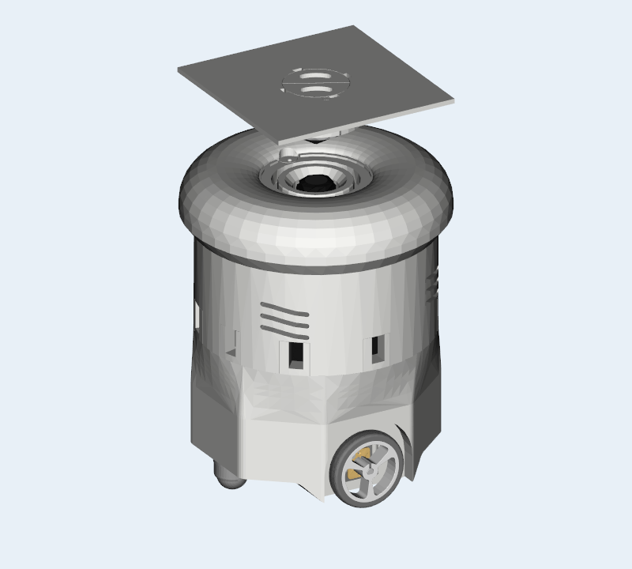

# Mini Qupa Description

Paquete de descripción del robot diferencial **Mini Qupa** para ROS 2. Incluye modelos URDF/Xacro, mallas visuales, archivos CAD originales y marcos de referencia de sus componentes.



*Vista del modelo renderizada a partir de las mallas del paquete.*

## Descripción del robot

Mini Qupa utiliza dos ruedas motrices y dos apoyos de bola. El modelo representa su estructura mecánica, electrónica y montaje de sensores.

| Sistema | Componentes representados |
| --- | --- |
| Tracción | Dos motores N20 y ruedas Pololu de 32 mm |
| Apoyo | Dos bolas de acero de 12,7 mm |
| Distancia | Ocho sensores Sharp GP2Y0E03 alrededor del cuerpo |
| Color del piso | Sensor TCS34725 orientado hacia abajo |
| Visión | Cámara OV5647 orientada hacia el espejo superior |
| Estructura superior | Soporte del espejo, placa plana para montar un AprilTag y difusor |
| Electrónica | Dos placas, Radxa Zero 3W y XIAO ESP32-C6 |

El ensamble tiene un ancho máximo de **108,4 mm** y una altura de **167,3 mm** sobre el plano nominal de rodadura. La separación entre los centros de las bandas de rodadura es de **79,5 mm**.

## Requisitos y compatibilidad

Los comandos siguientes usan una terminal Bash con el entorno de ROS 2 cargado.

- ROS 2 con `ament_cmake`, `colcon` y `rosdep` disponibles.
- Git y Git LFS para descargar los originales CAD.
- `xacro` y `urdf_launch`, declarados como dependencias del paquete.

`urdf_launch` proporciona el lanzamiento de visualización con RViz y los controles de las articulaciones. Las dependencias ROS se instalan con `rosdep` durante la instalación.

La versión actual es **0.3.0**. Se validaron la expansión del Xacro, la estructura del URDF, la carga de las mallas y la alineación de los marcos con el CAD. La distribución de ROS 2 y la ejecución en RViz y Gazebo están pendientes de verificación.

## Instalación y visualización

Clona el repositorio dentro de tu workspace y descarga los archivos administrados por Git LFS.

```bash
mkdir -p ~/ros2_ws/src
cd ~/ros2_ws/src
git lfs install
git clone https://github.com/mbyr0n/mini_qupa_description.git
git -C mini_qupa_description lfs pull
```

Instala las dependencias y compila el paquete. El ejemplo supone que `rosdep` ya está inicializado.

```bash
cd ~/ros2_ws
rosdep update
rosdep install --from-paths src/mini_qupa_description --ignore-src -y
colcon build --packages-select mini_qupa_description --symlink-install
source install/setup.bash
```

Abre el modelo en RViz.

```bash
ros2 launch urdf_launch display.launch.py \
  urdf_package:=mini_qupa_description \
  urdf_package_path:=urdf/qupa.urdf.xacro
```

Los controles `left_wheel_joint` y `right_wheel_joint` permiten girar cada rueda. En RViz, selecciona `base_footprint` como **Fixed Frame** si quieres usar la referencia al nivel del suelo.

## Estructura del repositorio

| Ruta | Contenido |
| --- | --- |
| [`cad/`](cad/) | Originales STEP, OBJ y MTL del ensamble |
| [`meshes/`](meshes/) | Cinco mallas DAE en metros, con los colores del CAD |
| [`urdf/qupa.urdf.xacro`](urdf/qupa.urdf.xacro) | Archivo principal editable del modelo |
| [`urdf/component_frames.xacro`](urdf/component_frames.xacro) | Marcos fijos de sensores y otros componentes |
| [`urdf/qupa.urdf`](urdf/qupa.urdf) | URDF generado a partir del Xacro |
| [`docs/modelo.md`](docs/modelo.md) | Dimensiones, coordenadas, orientaciones y criterios de montaje |

El OBJ y el STEP se almacenan con Git LFS. El archivo MTL conserva el nombre que referencia el OBJ. El paquete ROS instala las carpetas `urdf/` y `meshes/`.

## Modelo y configuración

El modelo utiliza **+X hacia delante, +Y hacia la izquierda y +Z hacia arriba**. El frente corresponde al lado del sensor de color inferior. `base_link` está entre las ruedas, a 16 mm sobre `base_footprint`.

Las dos ruedas utilizan articulaciones continuas. Los apoyos de bola y los marcos de los componentes tienen uniones fijas. La geometría visual de los componentes fijos forma parte de `base_link.dae`.

Edita el Xacro principal o el archivo de marcos según el cambio que necesites. Para actualizar el URDF, ejecuta desde la carpeta del paquete.

```bash
xacro urdf/qupa.urdf.xacro -o urdf/qupa.urdf
```

Los argumentos `camera_optical_xyz` y `camera_optical_rpy` permiten ajustar el marco óptico respecto a `camera_link`. Las ubicaciones nominales y los criterios de calibración están en la [documentación del modelo](docs/modelo.md).

## Estado de desarrollo

| Área | Estado |
| --- | --- |
| Geometría y materiales | Mallas actualizadas desde el último CAD |
| Estructura del modelo | 22 marcos y 21 articulaciones |
| Marcos de componentes | Ubicaciones y ejes contrastados con el STEP |
| Colisiones | Aproximaciones con cajas, cilindros y esferas |
| Cámara y sensores | Centros ópticos nominales pendientes de calibración |
| IMU | Modelo y ubicación del módulo pendientes de identificar |
| AprilTag | Plano de montaje definido. Posición y orientación del marcador pendientes |
| Dinámica y simulación | Masas, inercias, contacto de los apoyos y controlador pendientes |
| Pruebas en ROS 2 | Ejecución en RViz y Gazebo pendiente |

## Mantenedores, licencia y referencias

[](https://github.com/mbyr0n)
[](https://github.com/Walalex04)

Para consultas o reportes, utiliza las [issues del repositorio](https://github.com/mbyr0n/mini_qupa_description/issues).

Este proyecto se distribuye bajo la [licencia MIT](LICENSE).

- [Convenciones de unidades y ejes de ROS, REP 103](https://www.ros.org/reps/rep-0103.html)
- [Tutoriales de URDF para ROS 2](https://docs.ros.org/en/jazzy/Tutorials/Intermediate/URDF/URDF-Main.html)
- [Paquete urdf_launch](https://github.com/ros/urdf_launch)
- [Configuración de Git LFS](https://docs.github.com/en/repositories/working-with-files/managing-large-files/configuring-git-large-file-storage)
